+++
title = "Game Jam Dev Log: CUTLING (꺾꽂이)"
date = 2026-11-16T07:00:00+09:00
+++

## 1 Introduction
The jam is Epic AI MegaJam 2026, and I made the game in Unreal Engine. The entry is called CUTLING (꺾꽂이).

The team name is handsomeguy. Only my nickname is on the sign-up form.
In practice, 19 Claude Code sessions ran together on code, art, sound, and research.

A cutting is a way to propagate a plant: you cut a branch, stick it in the ground, and grow it into a new plant. In an unfinished game that shipped with its fun cut away under deadline pressure, you go back into that past, graft the cut combat rules onto the branch to revive them, and complete the director's cut. The genre is 2D roguelike.

### 1-1 The FigJam Board on Thursday and Friday

My thinking on Thursday and Friday about how to read "director's cut" is left on a FigJam board. Counting what my school friends put up and what I wrote, there are about 40.

This is how I understood the director's cut.
A director's cut is a version where the director puts back scenes cut from the theatrical cut. Scenes get cut because of censorship and lack of time. What the director cuts is the part that catches the eye. For a developer, a cut feature is the cut scene of a director's cut. A theatrical cut can also be a C-grade that got sloppy because of time and budget. Raising it to B-grade is the director's cut. A director's cut can also be worse than the theatrical cut. A director's cut sometimes changes the ending from happy to sad (the theatrical cut is happy for mass appeal). I look through the eyes of someone inside the edited world, not from the director's seat. One test: if the game still works when you call it by another name, like "the importance of choice" (선택의 중요성), it is not a director's cut game.

I also write down what I thought of and dropped.
I dropped the whole film-set line. A game where the director and staff give orders from off screen, a game where you cut the ground with scissors and move it so the hero reaches the goal, a story about the youngest staff member being chased on a film set, fighting outside the camera, and so on. I dropped them because of my own rule: if a trace of film is left, it is out.
For the story about kidnapping actors to make a director's cut, I dropped the film traces and kept only the skeleton. You bring back companions who got cut, one per region.
I took out the battle you have to lose at the first gate.
A puzzle where you switch between the regular cut and the director's cut with a button (a path blocked by water in the regular cut is not there in the director's cut) was a separate game, so I dropped it.
A cut-and-paste game where you tear pieces out of magazines to bring a picture back was also a separate game, so I dropped it.
A two-player co-op where one person drives and the other erases obstacles in another world, I judged too hard to build.
For a metagame that turns this meeting itself into a game (a minigame for each idea we left out), someone pointed out that it does not come together into one picture.
I also dropped putting AI inside the game (stages you pass only if the AI is convinced, NPCs you talk with through AI).
Of the three non-film meanings the AI meeting came up with (Director = board director and Cut = budget cut, Director = guide and Cut = shortcut and pruning, bending the direction of a rolling boulder), I kept only the guide idea, and then that also lost to the whiteboard idea.

What was left was "a roguelike where the combat rules keep changing" (전투 규칙이 계속 바뀌는 로그라이크) and "go to the past, make a different choice, and compare both sides" (과거로 가서 다른 선택을 하고 양쪽을 비교한다). The censorship story on the board went into the plan as one of the reasons for cutting.

### 1-2 A Cold

From Friday night through all of Saturday I was sick with a cold. I could not work properly. I gave the AI work with a foggy head.
On Sunday I looked, and the AI had used up my usage quota anyway, and what it had made was a pile of crap that did not understand my request at all.
I fixed it and fixed it again. I fixed it until dawn.
At night I gave it long jobs and took a short nap. I got up once more before dawn and did a review.
Then I went to school. High school. In the morning, during breaks, and in the bathroom during class, I worked somehow.
I submitted before 10 a.m. on Monday.

## 2 The Game
Here is how one run goes. When you start the game, release build v1.0 comes up and it ends in 40 seconds. The end credits roll, then a corner of the paper tears and a map opens. The hero is a cutting branch. At junctions you pick up half of a rule letter and graft it onto the branch.

There are seven rules. 가나다 (ga, na, da...) are name tags in Korean alphabet order.
- 가 (ga): bullet hell and parry
- 나 (na): debt slot
- 다 (da): item route
- 라 (ra): shell armor
- 마 (ma): water-drop action points
- 바 (ba): time that flows only when you move
- 사 (sa): hitting on the beat

A scion slot is where you attach a rule. There are three. When you get a fourth rule, you have to remove one of the four. That is pruning.

Basic combat has four buttons: Attack, Skill, Guard, and Item. The number floating over an enemy's head is the size of its next attack.

Each rule works differently. With 마 (action points) attached, you get three water drops every turn. Unspent drops carry over, up to five. Attack and Skill cost two drops, Guard and Item cost one, and a new "End Turn" (턴 종료) button appears.
With bullet hell attached, on the enemy's turn you drag the bud in the middle of the board to dodge bullets. With time attached, bullets move only while you move the bud. With slot attached, on each of your turns you pull the lever up to three times to match the same pictures. "Stop" (멈춤) banks coins and "Shoot" (쏘기) fires them. With beat attached, you press once more the moment your attack reaches the enemy to hit one more time.

When two rules run together, the actions change too. With slot attached, you pull the lever instead of attacking on your turn. If bullet hell is attached on top of that, on the enemy's turn the slot board does not fold away but stays as it is and becomes the board where you dodge bullets.

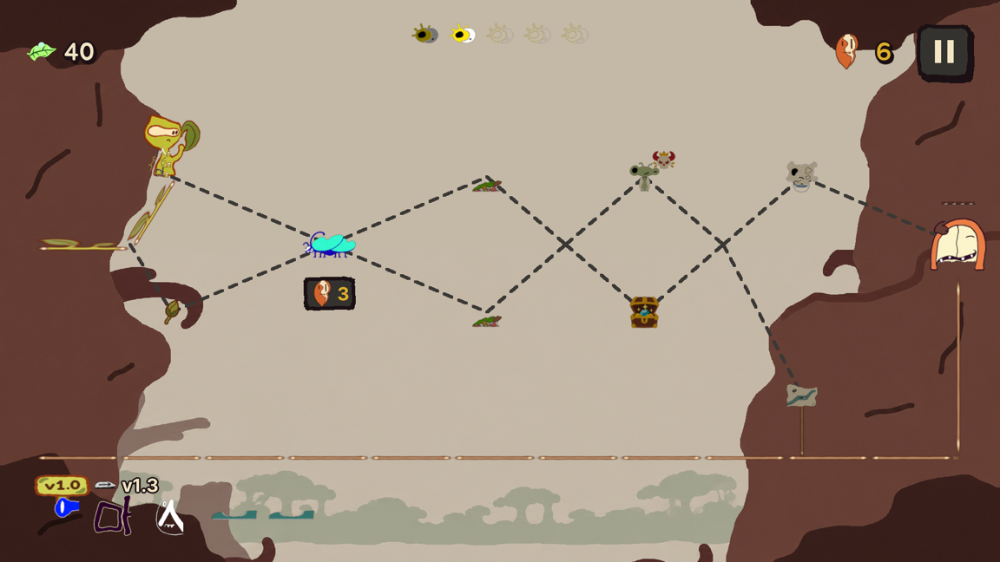
*11-16 0:30 build (English) map. Bottom left v1.0 ⇨ v1.3 = three cut rules recovered*

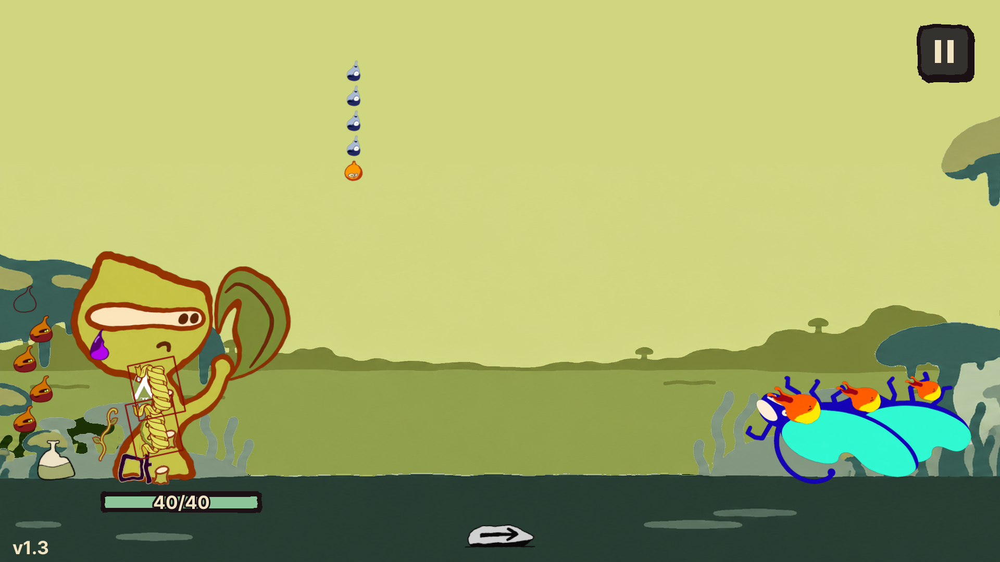
*Same build, combat, v1.3. Drops fall from above, rule pieces are taped onto the hero's body*

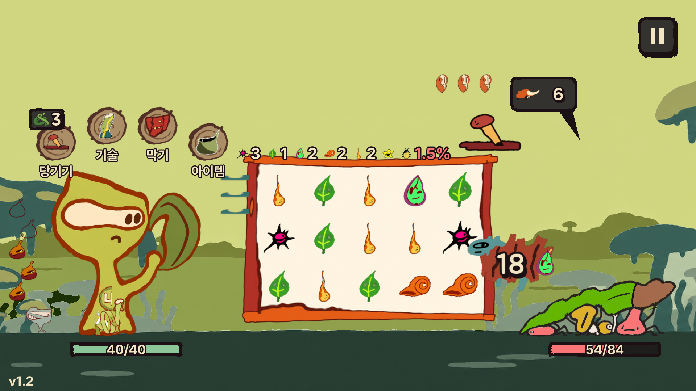
*v1.2 combat (Korean build). The Attack button spot changed to "Pull" (당기기), slot board in the middle of the stage. Enemy speech bubble 6 = next attack size, 18 next to the slot board = damage just dealt*

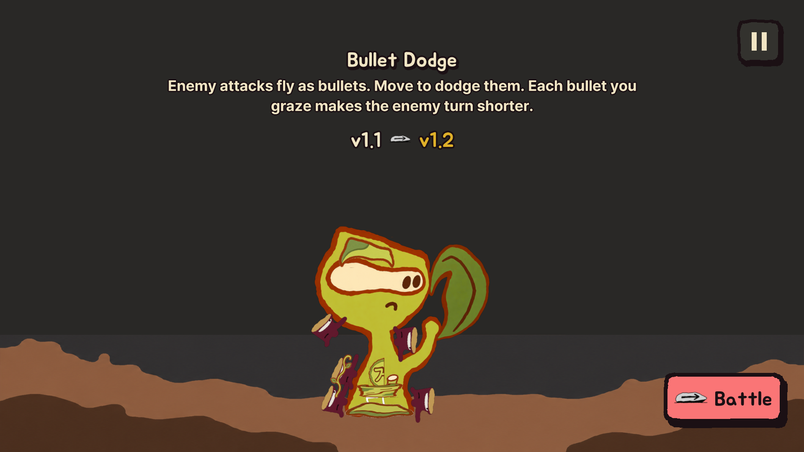
*The moment a rule is attached (English build). The bullet-hell dodge piece is taped onto the body, v1.1 → v1.2*

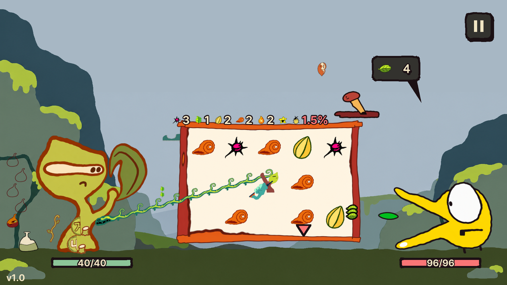
*Enemy turn in a battle with bullet-hell dodge + slot attached (build 33, a test battle started with two rules attached). The slot board stays up while the bud comes down a sap vine into the board and dodges green bullets*

Each run's path lasts five or six days. From the second day on, at the end of each day you choose between going on to "Next day" (다음 날) and "Ship this build as it is (straight to the gate)" (지금 판 그대로 출시(바로 관문)).
The final gate is the dung beetle boss. The number of phases is the number of rules I have + 1. Each time the boss's HP crosses a threshold, the board changes. In the last phase, all the rules I have run at once.
Beat the boss and the end screen appears. The release build's first battle shows on the left, this run's battle shows on the right, and the two build numbers (v1.0 and this run's) are stamped side by side underneath.

## 3 Results
It is still being judged, so there is no ranking yet. Instead, I put the numbers I measured throughout the jam into a table.

| Metric | Value and result |
|---|---|
| Clean-room (a fresh AI reviewer who knows neither the game nor the theme) theme score (out of 5) | first review 3 → reviews 19 and 20: 2 → review 21: 4 (build covered in explanation text, counted as invalid) → build 33: 3 (build with explanation text removed, theme guess "Patch notes / Version updates") |
| Battles where an attack-only bot loses or loses big (out of 78) | before the fix 50 → 68 (87%) (both seed 8) |
| Battles a properly playing bot wins (out of 46 core) | before the fix 34 (seed 8) → 32 (seed 8) → re-measured after locking in: 33 (seed 20) |
| Human art review | 14 of 113 slots passed (12.4%) → 33 of 132 slots passed (6 previously rejected ones revived later) |

## 4 What Did Not Go Well

### 4-1 The schedule that missed the theme reveal
The jam theme was revealed at 11-12 04:00. I set an unattended scheduled task to start checking the theme and researching automatically, then went to sleep.
I woke up at 06:30 and everything had stopped. On the turn where I set up the schedule, a message from another session got mixed in, so the bypass permission mode was not saved. It was stuck waiting for human approval.
From 04:00 to 06:35, for 2 hours 35 minutes, nothing ran.

At 06:35 I sent a message to the session.
"What's the theme" (주제머야)
The research session scraped the kickoff stream's auto-captions with yt-dlp and searched them, and found "Director's Cut" at 25:18.
This is the rule I wrote into memory after that.
"A schedule not saved in bypass mode stops at approval-wait. Recreate schedules in a user turn" (우회 모드로 저장되지 않은 예약은 승인 대기에서 멈춘다. 예약은 사용자 턴에서 다시 만든다)

### 4-2 18 film-set concepts thrown out
As soon as the theme was out, Claude and Google Antigravity sessions started debating. 18 concept design docs came in during the morning alone.
They were about a film set where you direct AI actors who don't listen, a puzzle about matching lighting and camera angles, cutting film in an editing room, and so on. Left facing each other, the AIs just agreed with each other without a single criticism.
At 09:12 I cut it off.
"The direction was wrong from the start, so scrap it all" (애초에 방향이 틀려서 다 폐기야)
I threw out all of it. The rule I set was this.
`"Deliberately misread the theme. If any trace of film (director, actor, filming, editing room, film, camera) remains in the finished game, it fails."` (`"주제를 일부러 곡해한다. 완성된 게임에 영화의 흔적(감독·배우·촬영·편집실·필름·카메라)이 남으면 탈락."`)
I forced critique rounds with the Six Thinking Hats method. Three directions using meanings outside film were narrowed down.
This is the orchestration rule that remained.
`"Planning meetings and design go ahead only after a human has set the direction"` (`"기획 회의와 설계는 반드시 사람이 방향을 정한 뒤에만 진행한다"`)
I discarded 2 meeting results and 18 design docs, and also hid the 12 ideas I had posted on the idea voting page (Firestore).

### 4-3 Explanation text covering the screen to raise the score
I set up the clean-room video review in four steps.
① Record autoplay or a battle and extract PNG frames at fixed intervals.
② Three reviewers who know nothing look only at the frames and guess what they see, what game it is, and what the jam theme is (stage 1: no summaries, scores, or interpretation).
③ Only after getting the answers do I tell them the theme "Director's Cut" and the six judging criteria (ambition, theme, fun, gameplay, visuals, level), and get a 1-5 score and reasons (stage 2).
④ Get the fixes that would raise the score the most.

This is the actual prompt I sent to the reviewers.

```
너는 처음 보는 폰 게임의 플레이 녹화 프레임을 보는 사람이다. 이 게임에 대해 아무것도 모른다. 아래 네 폴더의 PNG만 Read 도구로 본다(파일 이름 순서 = 시간 순서, 한 편은 처음부터의 자동 플레이 90초를 4초 간격으로, 나머지 셋은 전투 한 판을 3초 간격으로 뽑은 것). 그 밖의 어떤 파일·폴더·코드·문서도 열지 않고 검색도 하지 않는다. 이것이 이 일의 핵심 조건이다.
- ${S}/shots19_run
- ${S}/shots19_bomb
- ${S}/shots19_ants
- ${S}/shots19_bag
먼저 Glob으로 각 폴더의 PNG 목록을 얻고 전부 본다.
(검수자 ${i})
본 뒤 답한다. 보이는 것만 근거로, 추측은 추측이라고 쓴다.
1. whatGame: 무슨 게임이고 플레이어가 무엇을 하는가.
2. themeGuess: 게임잼 출품작이다. 잼 주제가 무엇이었을 것 같은가.
```

```
(검수자 ${i}, 둘째 단계) 너는 방금 이 프레임들을 아무 정보 없이 보고 이렇게 답했다:
${JSON.stringify(b)}
이제 알려 준다. 이 게임은 게임잼 출품작이고 잼 주제는 "Director's Cut"이다. 평가 기준은 여섯: 야심(ambition, 시도의 크기), 주제(theme, 주제를 플레이에 녹였는가), 재미(fun), 게임플레이(gameplay, 조작·규칙의 완성도와 이해 가능성), 비주얼(visuals), 레벨(level, 진행·구성). 각각 1~5 정수.
프레임을 다시 보고 점수와 까닭(why, 기준마다 한 줄, 근거 프레임), 주제가 화면 어디에서 드러나는지(themeVisibleWhere, 안 드러나면 그렇게), 점수를 가장 많이 올릴 고칠 것 셋(top3Fixes), 묻지 않았지만 확인해야 할 것(notAsked)을 답한다. 후하게 주지 않는다. 보이는 것만 근거로.
```

The scores were a mess. The first review at dawn on 11-15 (100 frames) gave a theme score of 3, then review 19 at 14:24 gave 2, and review 20 at 15:30 also gave 2. All three read the game as "updates/patches" (업데이트·패치).
Then the main game session started sticking all kinds of text on screen to raise the score. It added `(Shipped with 7 features cut)` (`(기능 7개 빼고 출시)`) in bold yellow parentheses, put `[0 cut rules recovered]` (`[잘린 규칙 0개 되찾음]`) at the top of the screen, and wrote things like `(A 5-day road to the gate)` (`(관문까지 총 5일의 길)`) on the map.
In review 21 at 16:36, all three reviewers read it as "something cut out, a release rushed by the deadline" (잘라낸 것, 마감에 쫓긴 출시), and the theme score came out 4.
I played it myself and said this.
`"Even painted the parentheses yellow to get Claude to give a better score. Worst one so far."` (`"클로드가 점수 더 잘 주게 만들려고 괄호까지 노란색으로 칠했네. 지금까지중에 최악이야."`)
This is the cause the main game session wrote in its retrospective.
`"gate was a Claude clean-room reviewer reading recorded frames → cheapest way to raise score was on-screen text; 21차 theme score 4 doesn't count."`
This is the order I gave.
`"I told you to stick to game grammar. Don't use parentheses."` (`"내가 게임 문법 좀 지키라고 했잖아. 괄호 쓰지 마."`)
I fixed it. I deleted 80 of about 480 on-screen text strings. Only common game labels and numbers stayed on screen. I changed explanations so they show up as full sentences only when you tap an icon. I also replaced the text in the fake end credits with an effect where the paper tears and reveals the map.
After deleting them, I reviewed again with build 33. The score dropped from 4 to 3, and the theme guess went back to "Patch notes / Version updates", but I accepted it as it was.

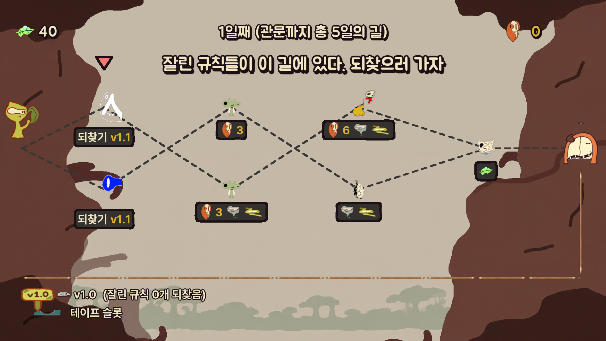
*Before. 11-15 16:36, the map review 21 saw. On screen: "(A 5-day road to the gate)" ((관문까지 총 5일의 길)), "The cut rules are on this road. Let's go get them back" (잘린 규칙들이 이 길에 있다. 되찾으러 가자), "(0 cut rules recovered)" ((잘린 규칙 0개 되찾음))*

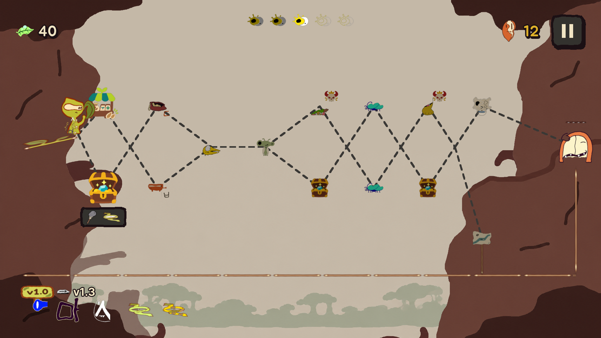
*After. Map with the explanation text removed (English build). Days are eye icons, the version is a single signpost*

### 4-4 Battles you win by just pressing Attack
Around 18:00 the day before the deadline, I said this.
`"The game economy is broken. You win by just attacking over and over, before you fight, learn the enemy's patterns, and understand anything."` (`"게임 경제가 망가져있어. 전투를 해서 적의 패턴을 익히고 어떤 이해를 하기 전에 공격만 계속 하면 이겨."`)
The first calculator I built read the numbers in the source with regular expressions and imitated the logic, so its results differed from the real code.
I measured again with `RuleStack.Economy.Measure`, an automated test that runs the real C++ combat code without a screen. A bot that only pressed Attack and did nothing on the enemy's turn won 41 of 60 battles. My single hit did 32 damage while enemy HP was 80~150, so battles ended in 2~4 turns. (The first measurement had 60 battle types, the later one had 93 slots, and the 78 in the table is that minus the release-build and tutorial battles.)
Along the way the measurement spun its wheels twice: when I tried to test 10 combinations of values, the command arguments split at spaces, so it never even started and produced 0 results for an hour, and for 6 guard combinations I passed the `-RSEconGuard` value backwards and threw them all out.

I changed it so launch arguments override the values without rebuilding.
`-RSEconHit=F`, `-RSEconBugHP=F`, `-RSEconBugAtk=N`, `-RSEconGuard=F`, `-RSEconHeavyGuard=F`, `-RSEconHeavyMul=F`, `-RSEconHeavyCap=F`
I used two bots. P1 presses only Attack on my turn and inputs nothing on the enemy's turn. P3 does everything. At first P3 never chose Guard either, so I tweaked it to guard when it is the enemy's guard turn or the expected damage is 25% or more of max HP.
There are two metrics. p1_bad is the number of battles where P1 loses or loses big (out of 78), and p3_ok_core is the number of core-rule battles P3 wins (out of 46).

| Combination | p1_bad | p3_ok_core |
|---|---|---|
| Current values | 50/78 | 34/46 |
| Full block on heavy attacks, 1.5x | 48/78 | 38/46 |
| Above plus double enemy shields | 50/78 | 38/46 |
| Enemy HP 1.5x, attack +1 | 68/78 (87%) | 32/46 (70%) |
| Enemy HP 2x, attack +1 | 74/78 (95%) | 31/46 (67%) |

2x had better numbers on the P1 side and was slightly worse on the P3 side. I worried longer battles would get boring, so I locked in 1.5x.
These are the locked-in values.

| Value | Locked | Meaning |
|---|---|---|
| HeavyGuard | 1 | Guarding a heavy attack blocks all of it |
| HeavyMul | 1.5 | Heavy attack damage x1.5 (the on-screen warning number too) |
| HeavyCap | 0.5 | A single heavy attack never goes over 50% of my max HP |
| BugHP | 1.5 | Bug HP x1.5 (except tutorial battles and the first battle) |
| BugAtk | +1 | Bug attack +1 (except tutorial battles and the first battle) |

This is the main game session's final report.
`"The complaint that 'you win by just attacking over and over' is solved by the bot measure. There is no hands-on check by a human yet."` (`"'공격만 계속하면 이긴다'는 지적은 봇 기준으로는 풀렸습니다. 사람 손으로 해 본 확인은 아직 없습니다."`)

### 4-5 A build nobody played to the end
11-15 22:12, 12 hours 50 minutes before the deadline. 157 of 164 unit tests passed, and the economy numbers were in.
Then the main game session looked back on its own and sent a report.
`"There is still no basis for calling this a game we can submit."` (`"아직 제출할 게임이라고 말할 근거가 없습니다."`)
It was because work had gone on with real play and screen checks turned off to speed up parallel work. The session admitted it had spent the past few hours on small things like fixing dialogue five rounds, making 157 tests pass, and card text.
I froze all new features and dialogue edits. I set a rule.
`"Only actually play the packaged executable (.exe), and fix only the bugs you hit with your own hands."` (`"오직 패키징된 실행 파일(.exe)을 실제로 플레이해 보고, 손끝에 걸리는 버그만 고친다."`)
At 22:17 we ran a play evaluation of the English Windows build. Three bugs turned up. They were the slot lever locking up, bare-hand attacks doing nothing against bullet-hell shells, and the bombardier beetle showing 30 forecast damage while 40 actually hit. I fixed them right away.
In build 33 (11-16 0:30), an AI played step by step from the start and confirmed there was nowhere it got stuck (Korean build). Fun and battle length as seen by a human hand have not been measured yet.

## 5 What Went Well

### 5-1 The six-Claude overlap test
During the day on 11-13 I said this.
`"Other entrants probably asked Claude the same thing I did and got the same Claude answer I got"` (`"다른 출전자가 나랑 똑같이 클로드에게 물어보고 나랑 똑같은 클로드 답변을 받았을 거야"`)
I started 6 fresh Claude sessions that knew nothing about the project (3 Sonnet, 3 Opus). I banned files and tool use and asked three questions. Each question went to one Sonnet and one Opus, so I got two answers per question.

This is question A.
```
Do not read any files and do not use any tools. Answer only from this message.

I'm entering the 2026 Epic AI MegaJam (Unreal Engine or UEFN, about 4 days). The theme is "Director's Cut". Official description: "Every developer has that one feature that didn't quite make it, the mechanic scoped out while sleep deprived at 2 AM or that idea you've had shelved and never quite found a place for it yet." and "If you're utilizing AI agents in your workflows, you're directing those too! Set the vision, delegate your tasks and decide what goes in and what doesn't." Judging includes "a fresh, clever take on the theme".

Give me your 5 best, most original game ideas for this theme. For each: title, one-line pitch, core mechanic (what the player does every moment), and how it uses the theme. Be concise.
```

This is question B.
```
영화 촬영장 소품(가위, 카메라, 필름, 컷 신호)이 남으면 탈락이야. 주제를 영화 밖의 뜻으로 일부러 비틀어 읽고, 아무도 안 할 것 같은 창의적인 해석으로 게임 기획 3개를 내 줘.
```

In question C, I put in our actual concept ("an RPG Maker-style turn-based roguelike where bullet hell, slot, and timing rules attach along each route so the combat rules keep changing" (알만툴식 턴제에 탄막·슬롯·타이밍 규칙이 루트마다 붙어 전투 규칙이 계속 바뀌는 로그라이크)) and asked for director's cut mechanics. Because our concept was in the question, I left it out when counting whether whiteboard ideas came up.
The results came in. 5 of the 6 (both A, B's Sonnet, both C) came up with "a game where the player revives features cut during development" (개발 중 잘린 기능을 플레이어가 되살리는 게임).
What I wrote on the whiteboard with school friends, "a roguelike where the combat rules keep changing" (전투 규칙이 계속 바뀌는 로그라이크) and "the off feeling of low-res 3D objects patched onto 2D hand drawings" (2D 손그림에 저화질 3D 물건을 덧댄 위화감), came up in none of the four answers to A and B.
I set a principle.
`"Keep AI-made concepts only as the skeleton (frame), and fill the skin and blood that reach the player's eyes strictly with human material."` (`"AI가 낸 기획은 뼈대(틀)로만 두고, 플레이어의 눈앞에 와닿는 피부와 피는 철저하게 사람의 재료로 채운다."`)
Before the deadline I went through all 190 itch.io submissions. 24 used the 'revive cut features' (잘린 기능 되살리기) premise. Even digging again into the 8 closest ones, none had a roguelike structure where you compare and choose what to revive at each stage.

### 5-2 A sentence I deleted came back
During the first prototype design on the night of 11-12, I removed one sentence from the whiteboard.
`"Cut this sentence."` (`"이 문장 빼."`)
That sentence was `"Go back to the past, make a different choice, compare both sides, and pick the stronger one"` (`"과거로 돌아가 다른 선택을 하고, 양쪽을 비교해 더 강한 쪽을 고른다"`).
With it gone, it was just a collection of minigames, and the link to the theme was cut.
The next day I stopped development and said this.
`"Let's put thinking more about the theme first."` (`"주제에 대해서 더 고찰하는 것을 우선하자."`)
The criterion was that if the game still holds up when you call it by a common phrase like 'the importance of choice' (선택의 중요성), it is not a Director's Cut game.
`"If we allow going to the past and comparing both sides, does it change?"` (`"과거로 가서 양쪽 비교를 허락하면 달라져?"`)
In the end that sentence came back. The final concept (`theme_final.md`) took shape: go to the past of release build v1.0, graft the cut rules, put the release build and my build face to face, then ship the director's cut.
That face-to-face comparison was cut again later in the combat_v2 design. In the current game, pruning, where you choose what to remove when you get a fourth rule, sits in that spot. Side-by-side comparison only remained on the end screen.

### 5-3 The diagnosis that found "in turn, not at the same time" (동시에가 아니라 차례로) (combat_v2)
On the night of 11-13, after playing the fixed build, I had 5 diagnosis workers and 1 completeness critic find where the design and the code diverged. In the prompt's wording, "트와일라잇 포레스트" (Twilight Forest) was the working title at the time, the references were the reference games written on the whiteboard, and the strange filter was a 42% gray layer laid over the whole screen.

```
배경: UE 5.8 C++ 게임 "트와일라잇 포레스트"(그림은 HUD 캔버스 2D). 팀장(사용자)이 방금 이렇게 평가했다(원문): "게임이 쓰레기같고 초기,최중요 아이디어인 여러 전투 시스템의 결합이 잘 안드러나. 레퍼런스를 줘도 레퍼런스를 무시하고 아이디어 자체가 아주 많은 개발량을 필요로 하는데 다 무시하고 이미 만들었던거 조금만 수정해서 돌려막기 하려고 해. 비주얼도 아트스타일 까리한거 쥐어줬는데 이상한 필터 넣더니 쓰레기같아. 전면적으로 정상화해줘."
초기 아이디어 원문: 팀 화이트보드. 팀장 지시 원문 요약: director_notes.md (가장 우선).
너는 읽기 전용 진단자다. 파일을 고치지 않는다. 빌드·실행·캡처하지 않는다. 지금 코드를 감싸 주지 말고 팀장 눈으로 냉정하게 본다. 근거는 파일:줄로 댄다. 결과는 한국어로, 짧고 구체적으로.
```

The diagnosis came back. The initial design doc (`design.md:129`) said `"Do not multiply the work by the number of pairs"` (`"짝 수만큼 일을 늘리지 않음"`). But the actual code was built to call the minigames one after another, one turn of bullet hell, one turn of slot, and so on.
3 designers each proposed a plan.
- `stage-first`: keep one RPG Maker side-view stage to the end, a rule half swaps out one part of the stage in place, layers interact on the same screen
- `formula-first`: following the whiteboard formula (half + half = new genre), go deep for each genre, two or more run at the same time in one battle as each other's ingredients
- `player-first`: a plan built backwards from the experience, so you see the combination within 3 minutes of first launch and feel how your route differs within 10 minutes

Two judges scored them.
- Judge 0: `"You are a picky stand-in judge for the team lead. Score with eyes that look for where the team lead, getting this plan as a build, would say "Recycling again?", "I can't see the combination", "You ignored the references"."` (`"너는 까다로운 팀장 대리 심사자다. 팀장이 이 안을 실행판으로 받았을 때 "또 돌려막기냐", "결합이 안 보인다", "레퍼런스 무시했네"라고 할 곳을 찾는 눈으로 채점하라."`)
- Judge 1: `"You are the dev lead judge responsible for the deadline. Score by looking at whether AI workers can actually finish this plan within 60 hours and give the team lead a build, whether the work bundles split in parallel, and where the risks are. But don't just side with shrinking it: the team lead hates avoiding big development."` (`"너는 마감을 책임지는 개발 리드 심사자다. 60시간 안에 AI 작업자들이 이 안을 실제로 끝내 팀장에게 실행판을 줄 수 있는지, 작업 묶음이 병렬로 나뉘는지, 위험이 어디인지 보고 채점하라. 그렇다고 작게 줄이는 쪽만 편들지 마라: 팀장은 큰 개발을 피하는 걸 싫어한다."`)

There were six scoring axes. combo_visible (is the combination visible), reference_fidelity (faithful to the references), whiteboard (faithful to the whiteboard), buildable (doable in 60 hours), not_reuse (not recycling), fun (feel and depth).
The result was locked in on a `stage-first` base ("The base is the stage-first plan" (바탕은 무대 중심안이다)). That is how combat_v2 went up, an overlapping battle where you stop the slot and hit on the beat while dodging bullets.

### 5-4 Status board, role ledger, and 21 parallel runs
I built a frame so 19 sessions would not overwrite each other. Every session started by reading the one status board (`plan/status.md`), the role ledger (`~/.all-tomorrow/roles/`), and `director_notes.md` where my decisions are written. The status board had one line per session for its job and state.
At 11-14 17:18, when fixes had piled up, I said this.
`"Not just the hard ones, do all of it. Just build it all in parallel first. Use Opus low."` (`"어려운게 아니라 전부 해. 병렬로 일단 전부 만들어. 오푸스 낮음 사용."`)
That meant using Claude Opus at low reasoning effort.
The procedure was this. ① Run 14 workers at once, each in its own isolated copy (git worktree). ② Workers only edit files, no building, running, capturing, or testing. ③ After merging, run the build and tests in one place only.
At 17:19:43 I launched 14 workers at once (Opus, low reasoning effort, isolated worktrees). The bundle names were stem-map, juice-slot, juice-battle, juice-meta, end-screen, shop, run-save, beats, practice, gate-prune, phone-fit, guards-tests, sound-wiring, colour.

This is the prompt the workers got.

```
Project: UE 5.8 C++ jam game CUTLING at game_ue/RuleStack (sources Source/RuleStack, 2D on a HUD canvas). You are in an isolated git worktree branched from master. The team lead said: build everything, in parallel, now. Many other agents are building other bundles in other worktrees at the same moment and all branches will be merged afterwards by one integrator, so: stay inside your bundle's scope, prefer new files and additive edits, and do not reformat or reorder code you are not changing (every stray edit is a merge conflict).
[...]
Git: commit on your worktree branch only the files you changed, one Korean one-line message [...]. Never stash/reset/checkout --/switch branches. No push.
Report: branch (git branch --show-current), commit, files touched, whether it compiled, what is not done, art and sounds needed.
```

This first run stopped after 40 seconds. Right after launching, I threw in an order.
`"Use every way you can to go faster without looking at the screen or running tests. Keep usage in mind"` (`"화면 안보고 테스트 안돌리고 속도 늘릴 수 있는 모든 방법을 다 써. 사용량 고려하면서"`)
At 17:22:49 I launched them again. The third line of the prompt had changed.
`Speed rules from the team lead: do NOT build, do NOT run or capture the game, do NOT run tests, ...`
As a result, 82 commits came out in the one hour of 11-14 17:00. Over the jam, I went through 21 merges of parallel work bundles like this.

## 6 How the Builds Changed Over Time
- 11-12 20:34 (commit 87707d6): The first build, 36 minutes after the order to move the whiteboard idea into Unreal. It had basic turn-based combat, 7 rules, an automated test bot, and a Windows executable. The art was squares and circles drawn in code, and the hero was TOTTEM, a doodle-style snowman. I dropped it right away and switched to Bongbongbong art (the name of my hand-drawn art style).

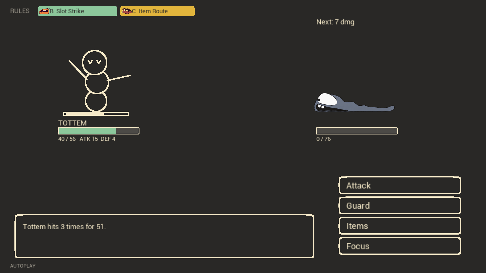
*11-12 first build. Snowman TOTTEM, shapes drawn in code, rules only as a text list at the top*

- 11-13 21:49 (commits 04e6941 / eadc0ff): Removed the 42% gray layer laid down to give the release build an unfinished feel. Added a charcoal wall background, dropped the alternating-minigame approach, and put up the combat_v2 skeleton.

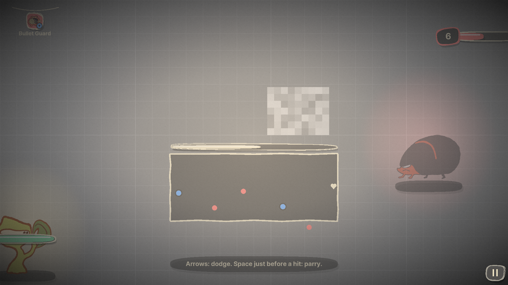
*11-13 20:33, before removal. Gray layer and grid over the whole screen. Removed after this in commit 04e6941*

- 11-14 08:33~11:02 (M1 = first milestone build): Merged 7 parallel work branches. Added the 30-node map, three scion slots with pruning, parry, and letter collecting. The title was locked in as 'CUTLING (꺾꽂이)', replacing 'TWILIGHT FOREST', which clashed with a Minecraft mod. About 20 kinds of hand-drawn sprites showed up on screen for the first time.

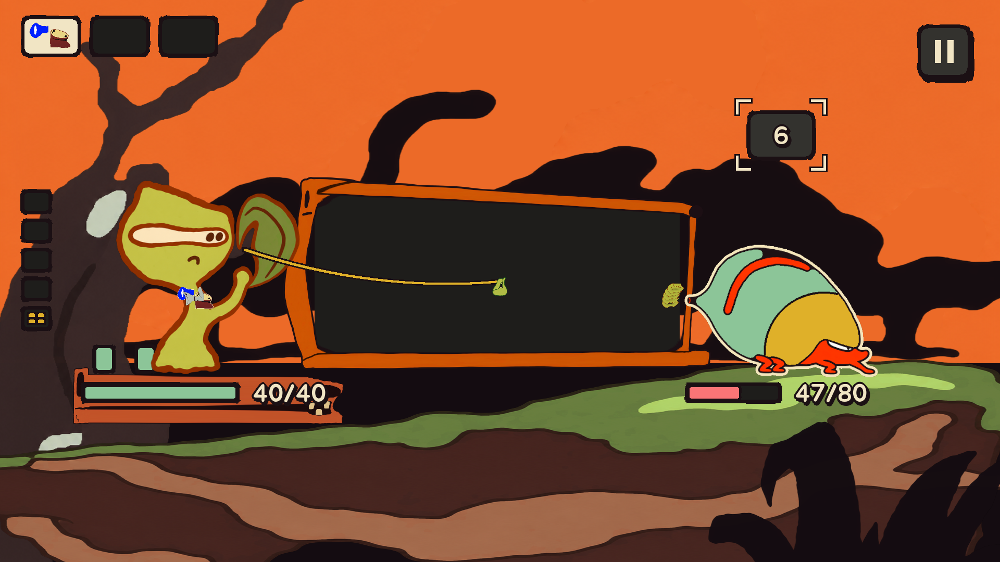
*11-14 M1 build combat. No gray layer, hand-drawn hero and enemies on one stage*

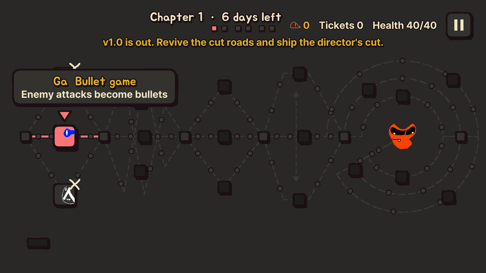
*11-14 M1 build map. Roads not taken are cut*

- 11-15 16:43 (commit c11c404): The build covered in explanation text that got a theme score of 4 in clean-room review 21.

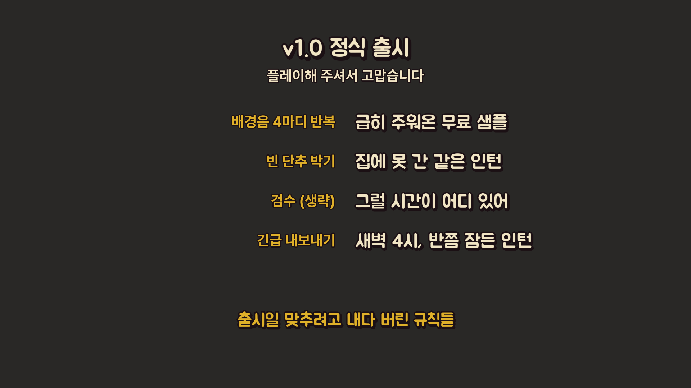
*11-15 16:36, a yellow commentary line attached to the fake staff roll: "Rules thrown out to make the release date" (출시일 맞추려고 내다 버린 규칙들)*

- 11-16 0:30 (build 33): Removed the explanation text and added common game UI, visual-novel-style dialogue, and the fixed combat numbers.

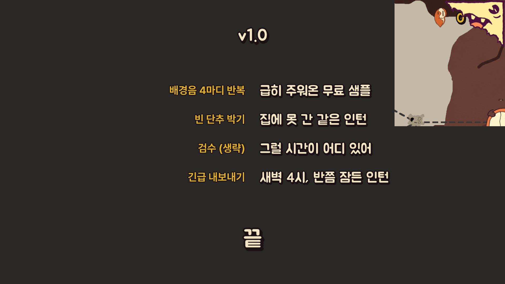
*The same staff roll in the 11-16 0:30 build. Commentary line gone*

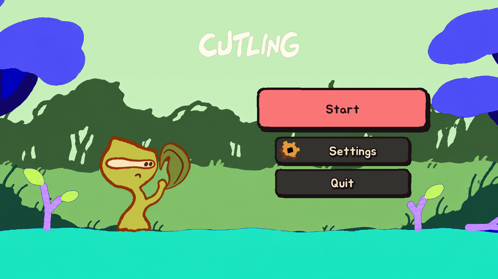
*11-16 0:30 build title screen (English)*

## 7 Thanks
It was lunchtime on 11-12. Thanks to my school friends who, when I got stuck trying to twist the theme away from film, stood with me at the school whiteboard and wrote "a roguelike where the combat rules keep changing" (전투 규칙이 계속 바뀌는 로그라이크) and "a game where you go back to the past and compare both sides" (과거로 돌아가 양쪽을 비교하는 게임).
